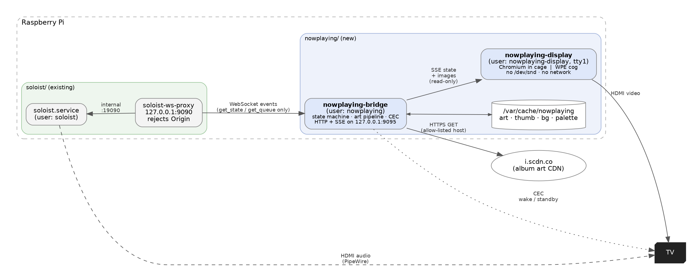

# Now Playing on the TV — Design

**Status:** built; tested on a desktop against a fake Soloist, not yet on a Pi.
The build simplified a few things in this design. See
[Changes made while building](#changes-made-while-building).

Show what Spotify is playing on the TV: album art, song title, artist and album,
with a progress bar. It updates as songs change. The look is an "Album Room" layout
that takes cues from Spotify's own now-playing view.

This is a new Retrofit TV component, `nowplaying/`. It sits next to `soloist/` and
only reads from Soloist's WebSocket API.

## Goals

- Show the current track on the TV, so it's readable from the couch (a "10-foot UI").
- Update right away on track change, pause, seek and device switch, without polling.
- Run well on a Pi 400. Stay usable on weaker boards (Pi 3 / Zero 2 class) for
  future smart-TV builds.
- Look best at 1080p, and scale to 4K by changing one setting.
- Keep the security model of `soloist/`: the display can't control playback, and it
  can't take the audio device.

## Non-goals (v1)

- Playback controls on the TV. The screen is display-only.
- Lyrics and video backgrounds. Soloist's API doesn't provide them.
- Running the display on a different machine from Soloist.

## Architecture



<sub>Source: [`docs/architecture.dot`](docs/architecture.dot). Regenerate with
`dot -Tpng -Gdpi=144 docs/architecture.dot -o docs/architecture.png`.</sub>

There are two services, each running as its own system user:

| Service | User | Job |
|---|---|---|
| `nowplaying-bridge` | `nowplaying` | Talks to Soloist. Turns events into one "screen state". Fetches and prepares art. Serves the page, images and an SSE stream. Drives CEC. |
| `nowplaying-display` | `nowplaying-display` | A full-screen browser on tty1 that shows `http://127.0.0.1:9095/`. Nothing else. |

**Design rule:** the bridge does the heavy work once per track. The browser only shows
ready-made images and text, and animates only `opacity` and `transform`. That keeps
the page cheap enough for weak GPUs.

### Why a bridge, not a page talking to Soloist

- `soloist-ws-proxy` refuses any connection that sends an `Origin` header, so
  browsers can't connect. That's intended, and we keep it.
- The bridge is a normal client. It connects through the proxy on `SOLOIST_WS_PORT`
  and sends no `Origin`. The `websockets` client only sends one if you pass `origin=`.
- The page gets a read-only stream over **server-sent events (SSE)**. The data only
  goes one way, so the screen can't send commands. Browsers also reconnect SSE on
  their own.

## Bridge (`nowplaying-bridge`)

Written in Python 3, using Debian packages only: `python3-websockets`, `python3-pil`,
and `v4l-utils` for `cec-ctl`. No pip.

### Connecting to Soloist

- **Port:** read `SOLOIST_WS_PORT` from `/etc/soloist/soloist.conf` (the default is
  9090), and connect to `ws://127.0.0.1:$SOLOIST_WS_PORT`.
- **On connect:** Soloist sends `auth_state`, then `playback_state` if it's logged in.
  The bridge then sends `get_queue` with `limit: 3`, because the snapshot doesn't
  include the queue.
- **On login:** when `auth_state.logged_in` changes to true and no snapshot has
  arrived, send `get_state` and `get_queue`.
- **On disconnect:** reconnect with backoff of 1, 2, 4 … up to 30 s. After
  reconnecting, the snapshot sent on connect brings the state back up to date.
- **Keepalive:** none. This is loopback, so if Soloist dies the socket closes.
  The bridge then reconnects.
- **Message types:** ignore unknown event types, so newer Soloist builds don't break
  the bridge. Log `error` events.

### How Soloist events update the state

| Soloist event | Bridge state it updates |
|---|---|
| `auth_state` | `logged_in`, `is_active`, `device_name` |
| `playback_state` | Replaces everything |
| `track_changed` | `item` → starts the art pipeline |
| `playback_changed` | `status` |
| `position_sync` | `position` (passed through unchanged) |
| `device_changed` | `is_active`, `device_name` |
| `context_changed` | `context` |
| `options_changed` | `options` (`repeat` is used for Up Next) |
| `queue_changed` | `up_next` = first `upcoming` entry → prefetch its art |
| `volume_changed` | `volume`, and sends a one-off `volume` SSE event |

### Turning an item into what's on screen

Field paths are from the API reference and match a real `soloist ctl now --json`
capture.

| On screen | Track (`entity_type: track`) | Episode (`episode`) |
|---|---|---|
| Title | `item.decorations.identity.name` | same |
| Subtitle | names from `creators[].entity.decorations.identity.name`, joined with ", " | creators (publisher). If missing, the show name. |
| Collection | `decorations.parent.entity.decorations.identity.name` (album) | parent (show) |
| Art | `decorations.visual_identity.cover[]` | the episode's cover, else the parent's |
| Explicit | `"explicit"` in `decorations.playback.content_ratings` | same |
| Duration | `decorations.playback.duration_ms` | same |

- **Optional fields:** every `decorations.*` field can be missing, so each one needs
  a fallback: an empty string, no badge, or the no-art layout.
- **Ads:** `entity_type: ad` gets a plain "Advertisement" card with no art and no
  progress bar.
- **"Playing from" label:**

  | Context | Label |
  |---|---|
  | `playlist` | "PLAYING FROM PLAYLIST" + the context name |
  | `artist` | "PLAYING FROM ARTIST" + the context name |
  | `album` with the same URI as the track's album | No label (it would repeat the album) |
  | `album` with a different URI | "PLAYING FROM ALBUM" + the context name |
  | Anything else that has a name | "PLAYING FROM" + the name |
  | Anything else with no name | No label |

### Screen state machine

The bridge decides the screen state, so every client agrees and the timers live in
one place.

```
          Soloist down >10 s, or logged_in = false
   ┌─────────────────────────────────────────────────────────┐
   ▼                                                         │
  OFF ──logged in──▶ IDLE ◀──is_active=false / status idle───┤
                      │  ▲                                   │
       status playing │  │ paused > NOWPLAYING_PAUSE_TO_IDLE │
                      ▼  │                                   │
        PLAYING ◀──▶ PAUSED                                  │
           ▲ │                                               │
           │ ▼                                               │
        BUFFERING ───────────────────────────────────────────┘

  IDLE for > NOWPLAYING_IDLE_TO_STANDBY (off by default) ──▶ CEC standby
```

- **The 10 s grace period** before OFF stops the screen flashing black when Soloist
  restarts or updates.
- **"Last played"** (title and artist) is kept in memory for the idle screen.

### Art pipeline

This runs on `track_changed`, and for `up_next` as a prefetch.

1. **Pick a source URL.**
   - Soloist's largest image is 640×640: `large` and `xlarge` are the same URL. The
     sizes are 64 (`small`), 300 (`default`) and 640 (`large`).
   - For 4K (`NOWPLAYING_SCALE=2`), album covers (URL path `ab67616d` + 8-character
     size code + ID) can be upgraded by swapping the size code for `000082c1`. That
     gives a **2000×2000** image. This is undocumented, so if it fails, use the 640px
     image.
   - At scale 1, always use the 640px image.
2. **Download.**
   - HTTPS only, and the host must be exactly `i.scdn.co`.
   - Max 5 MB, 10 s timeout, and the response must be `Content-Type: image/*`.
   - Pillow has a decompression-bomb limit (`Image.MAX_IMAGE_PIXELS`). Set it low,
     around 5000², since covers are never bigger than that.
3. **Make the files the page needs** (Pillow), all as JPEG quality 88:
   - `<key>-art.jpg`: resized to exactly 640 × scale px.
   - `<key>-thumb.jpg`: 64 × scale px, for the Up Next card.
   - `<key>-bg.jpg`: resized to 480×270, Gaussian blur with radius 24, darkened 30%.
     The browser stretches it full screen. The blur hides the low resolution, and the
     file is the same at 1080p and 4K.
4. **Pick colours.**
   - Shrink the image to 64×64 and quantize it to 8 colours.
   - Score each colour by pixel count × saturation, skipping colours that are almost
     black or almost white.
   - Darken the winner until white text on it has at least **4.5:1 contrast**. That
     gives `palette.base`.
5. **Cache.**
   - Files go in `/var/cache/nowplaying`, named by image ID.
   - Remove the oldest files when the cache goes over 200 MB.
   - Store the palette as a small `.json` file next to the images.
6. **Publish.**
   - Hold the track change until its art is ready, for at most 1.5 s. Then the
     page crossfades once, with the art, instead of showing a blank first.
   - If art fails or is missing, publish with `art: null` and the page shows the
     no-art layout.

### HTTP interface (127.0.0.1:9095)

| Path | Returns |
|---|---|
| `/` | `index.html` and its CSS, JS and fonts, from `www/` |
| `/events` | SSE stream (see below) |
| `/img/<file>` | Processed images from the cache |
| `/healthz` | `200` with `{"soloist": "connected" \| "down"}` |

- Listens on `127.0.0.1` only.
- Any request whose `Host` header isn't `127.0.0.1:9095` or `localhost:9095` gets a
  403. This blocks DNS-rebinding tricks from other pages.
- `GET` only. There are no write endpoints.

### SSE messages

On connect, and after every change, the bridge sends a **full snapshot**. It's under
2 KB, and full snapshots are simpler and more robust than sending diffs.

```
event: state
data: {
  "screen": "playing",              // off | idle | playing | paused | buffering
  "device_name": "Living Room TV",
  "track": {
    "key": "spotify:track:2K2M0TcglCRLLpFOzKeFZA",
    "kind": "track",                // track | episode | ad | unknown
    "title": "Sunshine Of Your Love",
    "subtitle": "Cream",
    "collection": "Disraeli Gears (Deluxe Edition)",
    "explicit": false,
    "duration_ms": 250400,
    "art": "/img/1b6093655d2c2d1f-art.jpg",   // or null
    "bg":  "/img/1b6093655d2c2d1f-bg.jpg",    // or null
    "palette": { "base": "#5a3b2e" }                  // or null → default #2a2a2a
  },
  "context": { "label": "PLAYING FROM PLAYLIST", "name": "Classic Rock" },  // or null
  "position": { "position_ms": 20821, "timestamp_ms": 1794858879688, "speed": 1 },
  "up_next": { "title": "Strange Brew", "subtitle": "Cream",
               "thumb": "/img/<key>-thumb.jpg" },                               // or null
  "last_played": { "title": "…", "subtitle": "…" },                         // or null
  "repeat": "off"
}

event: volume
data: { "volume": 72 }
```

- **Position:** `position` is passed through from Soloist unchanged. `timestamp_ms` is
  Unix-epoch wall-clock time, and the bridge and the page run on the same host, so
  the page can use it directly.
- **Up Next:** `up_next` is `null` when `repeat` is `track`, or when the next entry is
  the same track.

### CEC (`NOWPLAYING_CEC=1`, the default)

The bridge uses `cec-ctl` on `/dev/cec0`.

- **Startup:** register as a playback device with the OSD name set to `device_name`.
- **Playback starts** (moving into PLAYING from OFF or IDLE): send `image-view-on`
  and `active-source`. The TV turns on and switches to the Pi's input.
- **After a long idle:** after `NOWPLAYING_IDLE_TO_STANDBY` minutes in IDLE, send
  `standby`. **Off by default (`0`).** Knowing whether the Pi is still the active
  source means watching the CEC bus, which needs extra privileges
  (`CAP_NET_ADMIN`). So the Pi can't tell if someone switched the TV to another
  input, and turning standby on is the user's choice.
- **Missing `/dev/cec0`, or the TV doesn't answer:** log once and carry on without
  CEC.

## Display page

The page is one `index.html`, `app.css` and `app.js`, with no framework and no build
step. Fonts are bundled, and nothing is loaded from the network.

### Layout (1920×1080 CSS px)

```
x: 0    96  160                    800 880                                 1824 1920
   ┌──────────────────────────────────────────────────────────────────────────┐ 0
   │ safe area: 96 px left/right, 54 px top/bottom                            │ 54
   │                                                                          │
   │      ┌────────────────────────┐                                          │ 170
   │      │                        │                                          │
   │      │                        │  PLAYING FROM PLAYLIST · Classic Rock    │
   │      │      album art         │                                          │
   │      │      640 × 640         │  Sunshine Of Your Love           [E]     │
   │      │                        │  Cream                                   │
   │      │                        │  Disraeli Gears (Deluxe Edition)         │
   │      └────────────────────────┘  (text block bottom-aligned with art)    │ 810
   │                                                                          │
   │      0:20  ━━━━━━━━━●──────────────────────────────────────────  4:10    │ 890
   │                                                                          │
   │      ▮▮▮ Living Room TV                          ┌───────────────────┐   │ 930
   │                                                  │ ▣  UP NEXT        │   │
   │                                                  │    Strange Brew   │   │
   │                                                  └───────────────────┘   │ 1026
   └──────────────────────────────────────────────────────────────────────────┘ 1080
```

| Element | Spec |
|---|---|
| Background layer 1 | `<key>-bg.jpg`, `object-fit: cover`, 100% opacity (already darkened) |
| Background layer 2 | `linear-gradient(180deg, palette.base 0%, rgba(palette.base, .6) 35%, #121212 85%)` |
| Album art | 640×640 at (160, 170), `border-radius: 8px`, `box-shadow: 0 24px 64px rgba(0,0,0,.5)` |
| Text column | x = 880 to 1824 (944 wide), bottom-aligned at y = 810 |
| Context label | 22 px, weight 700, uppercase, `letter-spacing: .12em`, white at 70% |
| Title | 72/80 px, weight 700, white, at most 2 lines. If it doesn't fit, try 60/68 px first, then cut off with "…". |
| Explicit badge | 28×28, `border-radius: 4px`, black-on-white 18 px "E" at 60% opacity, before the artist (as in Spotify), so a cut-off title can't hide it |
| Artist | 40 px, weight 500, white at 70%, 1 line, cut off with "…" |
| Album | 32 px, weight 400, white at 50%, 1 line, cut off with "…" |
| Progress bar | x = 160 to 1760, y = 890. Track 6 px tall, white at 30%, radius 3. Fill white. No knob. |
| Time labels | 24 px, `font-variant-numeric: tabular-nums`, white at 70%, at each end of the bar |
| Device row | (160, 960): three animated bars in `#1DB954` (Spotify green, the only green on screen), then the device name in 24 px, white at 70% |
| Up Next card | 520×96, bottom-right inside the safe area, `rgba(0,0,0,.45)` with radius 12. 64 px thumbnail, "UP NEXT" label in 18 px, then "Title · Artist" in 26 px. |
| Font | Figtree variable font (OFL licence), `ttf`, in `www/fonts/` |

**No art:** the art box shows a `palette.base` square with a music-note icon and the
gradient uses the default `#2a2a2a`. For ads, the art box and the progress bar are
hidden and the title says "Advertisement".

### Screens

| Screen | What's shown |
|---|---|
| **Playing** | The layout above. The bars animate. |
| **Buffering** | Same as Playing, but the bars pulse slowly together instead of bouncing. |
| **Paused** | The whole stage dims to 60% opacity over 400 ms, a "Paused" pill (22 px, uppercase) appears above the title, the bars stop and the progress bar freezes. |
| **Idle** | Black (`#000`) background. Clock in 160 px weight 400 at 60% white, the date below it in 32 px, and "Last played · Title — Artist" in 24 px at 40% white. The whole block moves to a random spot within ±24 px every 60 s, with a 2 s ease, to avoid burn-in. |
| **Off** | Black. |

### Motion

All animations use only `opacity` and `transform`, which the GPU handles cheaply.

| Moment | Animation |
|---|---|
| Track change | Two layer sets (A and B). Load the new images into the hidden set, wait for `img.decode()`, then crossfade over 600 ms. The art also scales from 0.98 to 1. |
| Progress bar | See below. |
| Up Next | Shown when `remaining ≤ 20 s` and `duration ≥ 60 s`. It slides in (translateY 24 → 0 px and opacity over 400 ms) and goes away on the track change. |
| Volume overlay | A centred pill with an icon and a 300×6 bar. Fades in over 200 ms, stays 2 s, fades out over 400 ms. |
| Screen changes | 400 ms opacity. |

**Progress bar.** On each `state` event:

- Work out the current position: `p = position_ms + (Date.now() - timestamp_ms) * speed`,
  limited to between 0 and the track duration.
- **If `speed > 0`:** jump the fill to `p / duration` (the CSS `scaleX` value) with no
  transition. Then, in the next animation frame, set it to `1` with a linear
  transition that lasts `(duration - p) / speed` ms. The browser animates the bar
  with no JavaScript per frame.
- **If `speed == 0`:** freeze the fill at the current position.
- **Time labels:** a 1 s `setInterval` updates the text.

### Connection loss

- **SSE drops:** `EventSource` reconnects on its own. The page keeps showing the
  last state.
- **Bridge down for more than 10 s:** fade to the Off screen.

### Development

- `tests/fake_soloist.py` speaks the Soloist protocol, starting from the real
  `now --json` capture. It also accepts the real control commands (`pause`,
  `skip_next`, `seek` …).
- Run the real bridge against it, then open the page in a desktop browser at any
  size. No Pi or mock mode is needed.

## Kiosk (`nowplaying-display`)

`libexec/kiosk.sh` picks the browser from `NOWPLAYING_ENGINE`:

| Engine | Command (simplified) | When to use it |
|---|---|---|
| `chromium` | `cage -s -- chromium --kiosk --ozone-platform=wayland --incognito --mute-audio … http://127.0.0.1:9095/` | Pi 4 / 400 / 5. The installer picks it with ≥ 1.5 GB RAM. |
| `cog` | `cog --platform=drm http://127.0.0.1:9095/` | Pi 3 / Zero 2 class. Draws straight to the display, with no compositor. |

- **The engine is chosen once, at install time,** and written to the config, so the
  installer only installs that browser.
- **The kiosk waits for the bridge's port to open before starting the browser,** so
  it never shows a connection-error page.

The unit runs on tty1 with `User=nowplaying-display`, `PAMName=login`,
`TTYPath=/dev/tty1` and `After=nowplaying-bridge.service`. `cage` gets
`WLR_LIBINPUT_NO_DEVICES=1`, because the kiosk needs no input devices.

### Keeping the display away from the audio device

This needs care. The earlier "no sound" bug in `soloist/` happened because a
second PipeWire took the HDMI audio device. The kiosk must not do the same:

- **Block sound devices for the service.** Set `DevicePolicy=closed` with
  `DeviceAllow=char-drm rw`, `char-input r` and `/dev/tty1 rw`. This means no `/dev/snd`, even though logind gives the seat's
  active user access to sound devices.
- **Mask PipeWire for the display user.** `PAMName=login` starts a user manager for
  `nowplaying-display`. The installer stops PipeWire there by linking
  `pipewire.{service,socket}`, `pipewire-pulse.{service,socket}` and
  `wireplumber.service` to `/dev/null` in that user's
  `~/.config/systemd/user/`.
- **Mute Chromium:** pass `--mute-audio`.
- **Check it** with an end-to-end test: play music, start the kiosk, and confirm in
  `wpctl status` (as the `soloist` user) that Soloist still has the HDMI sink.

### Sandbox limits

Chromium's own sandbox needs user namespaces and a writable JIT. So the display
service *can't* use `RestrictNamespaces`, `MemoryDenyWriteExecute` or a tight
`SystemCallFilter`. Its security comes from these instead:

- a dedicated user
- a home under `/var/lib/nowplaying-display` for the browser profile; Chromium runs
  in `--incognito`. There's no `ProtectSystem=strict`: the logind session's
  runtime directory has to stay writable, and the unprivileged user can't write
  system paths anyway.
- `PrivateTmp` and the kernel-protection settings
- `IPAddressAllow=localhost` and `IPAddressDeny=any`, so the browser can't reach
  the network at all
- the device policy above

## 4K

The page is laid out at 1920×1080 CSS px and **zooms itself** to the screen
(`zoom = min(width/1920, height/1080)`). That gives the same layout at 720p, 1080p
and 4K with no browser flags, and the text stays sharp because zoom re-lays the page
out instead of scaling a bitmap. `NOWPLAYING_SCALE=2` (`install.sh --4k`) only
changes the art resolution. It's a setting rather than auto-detected, because weak
boards should output 1080p even on a 4K TV.

| What | At 1080p (`SCALE=1`) | At 4K (`SCALE=2`) |
|---|---|---|
| Layout and text | As specified | Unchanged. The page zooms 2× and text and shapes stay sharp. |
| Art source | 640px (Soloist `large`) | 2000px CDN version, resized to 1280. Falls back to 640px, which looks a bit soft. |
| Up Next thumbnail | 64px | 128px, cut from the same downloaded cover |
| Blurred background | 480×270 | Same |
| HDMI output | 1080p60 | Pi 4/400: `hdmi_enable_4kp60=1` for 60 Hz. **4K30 is enough** for this mostly static screen and is easier on the GPU. Zero 2 can't output 4K: use 1080p and let the TV upscale. |
| Cost | — | 4× the pixels to composite. The Pi 400 should handle it. Check that the crossfade stays smooth. |

## Configuration

The config file is `/etc/nowplaying/nowplaying.conf`, loaded with systemd
`EnvironmentFile=`:

```sh
NOWPLAYING_PORT=9095              # bridge HTTP/SSE on 127.0.0.1
NOWPLAYING_ENGINE=chromium        # chromium | cog (chosen by install.sh)
NOWPLAYING_SCALE=1                # 1 = 1080p art, 2 = 4K art
NOWPLAYING_CEC=1                  # 1 = wake TV on play
NOWPLAYING_PAUSE_TO_IDLE=10       # minutes paused before the idle screen
NOWPLAYING_IDLE_TO_STANDBY=0      # minutes idle before CEC standby (0 = never)
NOWPLAYING_CACHE_MB=200
```

The Soloist port and device name are read from `/etc/soloist/soloist.conf`, so it isn't duplicated
here.

## Security model

- **The display can't control playback.**
  - The page only receives SSE, and the bridge has no write endpoints.
  - The bridge never sends playback commands to Soloist. It only sends `get_state`
    and `get_queue`.
- **Soloist's protections stay on.** The bridge goes through `soloist-ws-proxy` like
  any other trusted local client. `SOLOIST_WS_PROTECT=1` is unchanged.
- **Bridge sandbox:**
  - A dedicated user, no capabilities, and `ProtectSystem=strict` with
    `CacheDirectory=nowplaying`.
  - `DevicePolicy=closed`, `DeviceAllow=/dev/cec0 rw` and
    `SupplementaryGroups=video`.
  - No `IPAddressDeny=`, because it needs the internet for art.
  - `RestrictAddressFamilies=AF_INET AF_INET6 AF_UNIX`, plus the same hardening as
    `soloist-ws-proxy.service`.
- **Network access is limited in code.**
  - The bridge needs outbound HTTPS for art. systemd can't limit access by hostname,
    so the code only fetches from `https://i.scdn.co/`. It doesn't follow redirects,
    and it checks size, content type and pixel count before decoding.
  - Images are decoded inside the sandbox.
- **Local web server:** it listens only on `127.0.0.1`, checks the `Host` header to
  block DNS rebinding, and is read-only.
- **The display gets no audio and no network access.** See the kiosk section.

## Files

```
nowplaying/
├── DESIGN.md, README.md
├── install.sh, uninstall.sh      same style as soloist/
├── config/nowplaying.conf.example
├── bridge/                       → /usr/local/libexec/nowplaying/bridge
│   ├── __main__.py               Soloist client, wiring, timers, CEC triggers
│   ├── state.py                  event → state mapping, screen state machine (no I/O)
│   ├── art.py                    fetch, resize, blur, palette, cache
│   ├── server.py                 HTTP + SSE
│   └── cec.py                    cec-ctl wrapper
├── libexec/kiosk.sh              → /usr/local/libexec/nowplaying/kiosk
├── www/                          → /usr/local/share/nowplaying/www
│   ├── index.html, app.css, app.js
│   └── fonts/                    Figtree + OFL licence
├── systemd/
│   ├── nowplaying-bridge.service
│   └── nowplaying-display.service
├── docs/architecture.{dot,png}
└── tests/
    ├── fixtures/playback_state.json   real `soloist ctl now --json` capture
    ├── fake_soloist.py           fake Soloist for development
    └── test_state.py             mapping and state machine (stdlib unittest)
```

The bridge runs as `python3 -I <dir>`. A package directory works under isolated
mode, so the modules import each other without changing `sys.path`.

`install.sh` does the following, and is safe to re-run:

- installs the apt packages
- creates both users
- masks PipeWire for the display user
- copies the files into place and installs the units
- writes the config only if it doesn't already exist
- enables both services

## Changes made while building

The build kept the design but simplified these parts:

| Design said | Built | Why |
|---|---|---|
| WebSocket pings every 20 s | No pings | Loopback: a dead Soloist closes the socket. One less unknown. |
| Standby only if the Pi is still the active source | Standby off by default | Tracking the active source means monitoring the CEC bus, which needs `CAP_NET_ADMIN`. |
| Browser scale-factor flags for 4K | The page zooms itself | Same result, works on any resolution, and no per-browser flags. |
| `NOWPLAYING_ENGINE=auto` at runtime | Chosen by `install.sh` | Only one browser gets installed. |
| `?mock=` mode in the page | `tests/fake_soloist.py` | Tests the real bridge too, and keeps test code out of the page. |
| Explicit badge after the title | Before the artist | A long title cut off with "…" was hiding it. |
| Hold all updates until art is ready | Same, in order | The handler waits up to 1.5 s for art before applying a track change, so later events queue behind it and nothing arrives out of order. |
| — | Hold the last screen until the first snapshot | `auth_state` arrives just before `playback_state`, which briefly flashed the idle clock on connect. |

## Still to do on a Pi

1. **Pi 400:** install, play music, and check the screen. Check that audio still plays
   (the audio-isolation test in the kiosk section).
2. **CEC:** check that the TV wakes and switches input.
3. **Weak board:** run the `cog` engine on a Pi 3 or Zero 2. If the crossfade or
   progress bar stutters, the fallback is a native SDL renderer that reads the same
   `/events` feed. The bridge doesn't change.
4. **4K TV:** try `NOWPLAYING_SCALE=2`.

## Open questions to check

- **2000px art:** the `000082c1` version is undocumented. It worked for the test
  track. Check it on a sample of albums, and keep the 640px fallback either way.
- **Audio isolation:** do the `DevicePolicy` and masked PipeWire block HDMI audio in
  practice? Logind's sound-device access for the seat user is the risk.
- **Attribution:** do Spotify's developer or Soloist terms require attribution when
  showing metadata and art, such as a Spotify logo? If they do, add a small mark to
  the device row.
- **CEC:** do the target TVs actually honour `image-view-on`, `active-source` and
  `standby`? This varies by brand and age.
