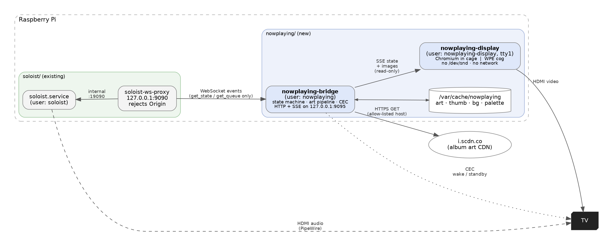

# Now Playing on the TV

Shows what Spotify is playing on the TV: album art, song, artist and album, with a
progress bar. It updates as songs change. When nothing is playing, it shows a clock.
It reads from the [Soloist](../soloist/README.md) component, so install that first.



How it's built and why: [DESIGN.md](DESIGN.md).

## Install

Copy this directory to the Pi and run:

```bash
sudo ./install.sh
```

The screen takes over the Pi's HDMI output (tty1). Pick the Pi in the Spotify
app and the TV shows the track.

Options:
- `--engine chromium|cog` picks the browser. By default it uses Chromium on boards
  with 1.5 GB RAM or more, and the lighter `cog` (WPE WebKit) on smaller boards.
- `--4k` fetches sharper album art for a 4K TV. The layout scales to any
  resolution on its own.
- `--no-cec` stops the Pi turning the TV on when music starts.

Re-running the installer is safe. It keeps `/etc/nowplaying/nowplaying.conf`.

## Settings

Settings are in `/etc/nowplaying/nowplaying.conf` ([example](config/nowplaying.conf.example)).
After editing, run:
`sudo systemctl restart nowplaying-bridge nowplaying-display`.

| Setting | Default | |
|---|---|---|
| `NOWPLAYING_ENGINE` | `chromium` or `cog`, chosen at install | The browser |
| `NOWPLAYING_SCALE` | `1` | `2` for a 4K TV |
| `NOWPLAYING_CEC` | `1` | Turn the TV on and switch to the Pi when music starts |
| `NOWPLAYING_PAUSE_TO_IDLE` | `10` | Minutes paused before the clock shows |
| `NOWPLAYING_IDLE_TO_STANDBY` | `0` (never) | Minutes on the clock before the TV goes to standby |
| `NOWPLAYING_PORT` | `9095` | Port for the page and its feed, on 127.0.0.1 only |

Standby is off by default. The Pi can't tell whether someone has switched the TV to
another input, so a standby command could turn the TV off in the middle of a film.

## What gets installed

| Path | Purpose |
|---|---|
| `nowplaying-bridge.service` | Runs as `nowplaying`. Follows Soloist, prepares album art, serves the page on `127.0.0.1:9095`, and turns the TV on. |
| `nowplaying-display.service` | Runs as `nowplaying-display` on tty1. A full-screen browser that shows the page. |
| `/usr/local/libexec/nowplaying/` | The bridge (Python) and the kiosk launcher |
| `/usr/local/share/nowplaying/www/` | The page, plus the Figtree font (SIL Open Font License) |
| `/var/cache/nowplaying/` | Prepared album art, trimmed to 200 MB |

## Security

- **The screen can't control playback.**
  - The page only receives a read-only feed.
  - The bridge only *reads* from Soloist and never sends playback commands.
  - The bridge connects through `soloist-ws-proxy` like any trusted local tool,
    so Soloist's browser protection stays on.
- **The bridge serves only `127.0.0.1`.** It answers only `GET` requests, and only
  when the `Host` header names it, which blocks DNS-rebinding tricks. It downloads
  images only from `https://i.scdn.co/`, with size and type limits, and processes
  them inside its sandbox.
- **The display has no audio access.**
  - Its service can't open `/dev/snd`.
  - PipeWire is masked for its user.
  - Chromium runs with `--mute-audio`.

  This stops it taking the HDMI audio device from Soloist.
- **The display has no network access.** It can only reach `127.0.0.1`.

## Development (no Pi needed)

```bash
python3 -m unittest discover -s tests                     # tests
python3 tests/fake_soloist.py --port 19090 &              # a fake Soloist
SOLOIST_WS_PORT=19090 NOWPLAYING_CEC=0 python3 -I bridge  # the bridge (art cache: ~/.cache/nowplaying)
# open http://127.0.0.1:9095/ at 1920x1080, then drive the fake:
python3 tests/fake_soloist.py --port 19090 send pause     # also: play, skip_next,
                                                          # seek MS, set_volume N, deactivate
```

The diagram is generated from [`docs/architecture.dot`](docs/architecture.dot) with:
`dot -Tpng -Gdpi=144 docs/architecture.dot -o docs/architecture.png`.

## Troubleshooting

- **Black screen.** Check `journalctl -u nowplaying-display`. A "Permission denied"
  on a `/dev/...` device means the device rules in `nowplaying-display.service` are
  too tight for your board. Add a `DeviceAllow=` line for that device, then run
  `sudo systemctl daemon-reload` and restart.
- **The screen shows the clock but music is playing.** Check
  `journalctl -u nowplaying-bridge`. It should say `Connected to Soloist`. If it
  says `403`, something is adding an `Origin` header, which shouldn't happen.
- **No sound after installing.** Run
  `sudo -u soloist XDG_RUNTIME_DIR=/run/user/$(id -u soloist) wpctl status`. The
  HDMI sink should belong to Soloist. If the display's PipeWire is running
  (`loginctl user-status nowplaying-display`), the masking in `install.sh` didn't
  work. Please report it.
- **The TV doesn't turn on.** Some TVs ignore CEC or have it turned off in their
  menus; look for "Anynet+", "Bravia Sync" or "SimpLink". `cec-ctl -d /dev/cec0 --playback`
  should print a physical address other than `f.f.f.f`.
- **The art looks soft on a 4K TV.** Set `NOWPLAYING_SCALE=2`.
